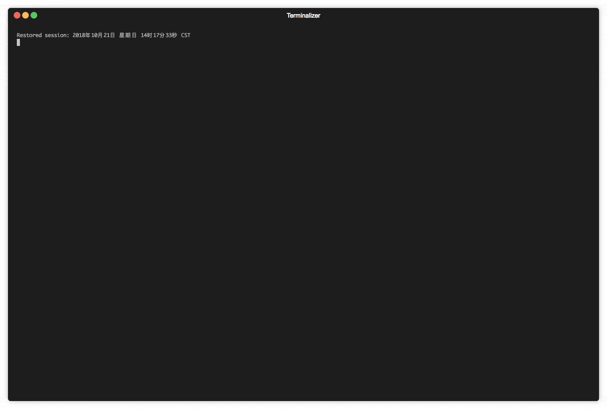

# media2ascii

**Transforme fotos e vídeos em arte ASCII, direto no seu terminal.** Colorido ou preto e branco, com áudio, centralizado na tela.



```bash
media2ascii foto.jpg        # imagem vira ASCII na hora
media2ascii video.mp4       # vídeo toca em ASCII, com som (macOS/Windows)
```

## ✨ O que ele faz hoje

- 🖼️ **Imagens** JPG e PNG convertidas em ASCII, ajustadas ao tamanho do terminal
- 🎞️ **Vídeos** (`.mp4`, `.mov`, `.mkv`, `.avi`, `.webm`, `.m4v`, `.wmv`, `.flv`, `.mpeg`, `.mpg`, `.3gp`) tocados quadro a quadro via `ffmpeg`
- 🎨 **Cor real (24 bits)** ou **preto e branco**
- 🔊 **Áudio sincronizado ao iniciar** no macOS (`afplay`) e no Windows (PowerShell)
- ⏯️ **Pausa com ESPAÇO** e menu para trocar FPS, cores e áudio sem sair do programa
- 🎬 **`--export`**: salva cada quadro em `.txt` e gera um `.mp4` da arte ASCII
- ⚡ Conversão paralela em todos os núcleos da CPU
- 📦 Binário único em Go; a única dependência externa é o `ffmpeg` (só para vídeo)

## 📥 Instalação

### Binário pronto (recomendado)

Baixe na página de **[Releases](https://github.com/Andrelbmachado/media2ascii/releases)**:

| Sistema | Arquivo |
|---|---|
| macOS (Apple Silicon) | `media2ascii_darwin_arm64.tar.gz` |
| macOS (Intel) | `media2ascii_darwin_amd64.tar.gz` |
| Windows (x64) | `media2ascii_windows_amd64.zip` |
| Windows (ARM) | `media2ascii_windows_arm64.zip` |
| Linux (x64 / ARM64 / ARMv7) | `media2ascii_linux_{amd64,arm64,arm}.tar.gz` |
| FreeBSD (x64) | `media2ascii_freebsd_amd64.tar.gz` |

```bash
# macOS / Linux: extrair e colocar no PATH
tar -xzf media2ascii_darwin_arm64.tar.gz
sudo mv media2ascii_darwin_arm64 /usr/local/bin/media2ascii
```

> **macOS:** se o Gatekeeper bloquear o binário baixado, rode `xattr -d com.apple.quarantine /usr/local/bin/media2ascii`.

### Com Go (1.25+)

```bash
go install github.com/Andrelbmachado/media2ascii/v2@latest
```

### Homebrew

```bash
brew tap Andrelbmachado/media2ascii && brew install media2ascii
```

> ⚠️ A fórmula do tap ainda aponta para a **v1.1.0**, que usa uma sintaxe antiga. Atualizá-la automaticamente é **planejado** (ver [PLANO.md](PLANO.md), Fase 3). Por enquanto, prefira o binário do Release ou `go install`.

### Instalar o ffmpeg (necessário só para vídeo)

| Sistema | Comando |
|---|---|
| macOS | `brew install ffmpeg` |
| Windows | `winget install Gyan.FFmpeg` (depois reabra o terminal) |
| Debian/Ubuntu | `sudo apt install ffmpeg` |

## 🚀 Uso

```text
media2ascii <arquivo> [qualidade] [fps] [cores] [audio] [--export] [--no-audio]
```

Os parâmetros são **posicionais**: para informar `fps`, informe também `qualidade` antes.

| Parâmetro | Valores | Padrão | Observação |
|---|---|---|---|
| `arquivo` | imagem ou vídeo | — | o tipo é detectado pela extensão |
| `qualidade` | `0`–`100` | `100` | ⚠️ aceito e validado, mas **ainda não altera o resultado** (planejado) |
| `fps` | número > 0 | `30` | só vídeo |
| `cores` | `Color` / `BW` (também `cor`, `colorido`, `pb`, `preto`) | `Color` | |
| `audio` | `ON` / `OFF` | `ON` | áudio só no macOS e Windows |
| `--export` | — | — | só vídeo; gera `<nome>_ascii.mp4` e a pasta `<nome>_ascii_frames/` ao lado do original |
| `--no-audio` / `--mute` | — | — | o mesmo que `audio OFF`; pode ir em qualquer posição |

### Exemplos

```bash
# Imagem com as configurações padrão
media2ascii foto.jpg

# Imagem em preto e branco (qualidade e fps precisam vir antes)
media2ascii foto.png 100 30 BW

# Vídeo a 12 fps, colorido, sem áudio
media2ascii video.mp4 100 12 Color OFF

# Exportar a arte ASCII de um vídeo para MP4
media2ascii video.mp4 100 24 --export
```

## 🎮 Controles durante o vídeo

| Tecla | Ação |
|---|---|
| `ESPAÇO` | Pausa e abre o menu |
| `Q` ou `Ctrl+C` | Para imediatamente |

No menu (aparece na pausa e ao fim do vídeo), digite um comando e tecle `ENTER`:

| Comando | Ação |
|---|---|
| `ENTER` (vazio) | Continua (na pausa) ou repete o vídeo (no fim) |
| `fps <n>` | Altera o FPS (ex.: `fps 12`) |
| `cores BW` / `cores Color` | Preto e branco ou colorido |
| `audio ON` / `audio OFF` | Liga ou desliga o áudio (aplicado na hora) |
| `qualidade <0-100>` | Aceito, mas ainda sem efeito visual (planejado) |
| `Q`, `sair`, `exit` | Sai do programa |

> Na pausa, mudanças de `fps` e `cores` passam a valer **no próximo replay**; só o áudio muda na hora.

## 🧭 Status por plataforma

| | macOS | Windows | Linux |
|---|---|---|---|
| Compila (cross-compile) | ✅ | ✅ | ✅ |
| Testes automatizados (`go test ./...`) | não rodados | não rodados | ✅ |
| Uso real confirmado | ⏳ pendente | ⏳ pendente | ⏳ pendente |
| Áudio no vídeo | ✅ `afplay` | ✅ PowerShell | ❌ planejado |

Verificado em 21/10/2026. O roteiro de testes manuais está no [PLANO.md](PLANO.md), Fase 1.

## ⚠️ Limitações conhecidas

- **`qualidade` não tem efeito**: o valor é lido, mas não é repassado ao conversor (planejado, Fase 2).
- **Redimensionar a janela durante o vídeo**: o tamanho do quadro acompanha o terminal, mas a centralização usa o tamanho medido ao iniciar. Suporte completo é **planejado** (Fase 2).
- **`--export`** sempre exporta colorido e usa o tamanho do terminal atual, não uma resolução fixa (Fase 2).
- **GIF animado, WebP e webcam** não são suportados.

## 🛠️ Desenvolvimento

```bash
git clone https://github.com/Andrelbmachado/media2ascii.git
cd media2ascii
go test ./...          # testes
go run . foto.jpg      # rodar local
make all               # gera os binários de todas as plataformas em dist/
```

Estrutura: `main.go` (CLI, player, áudio, export) · `convert/` (redimensionamento e conversão) · `ascii/` (pixel → caractere) · `terminal/` (tamanho do terminal) · `npm/` (wrapper npm com `ffmpeg-static`; publicação no registro ainda não verificada).

Próximos passos e critérios de pronto: **[PLANO.md](PLANO.md)**.

## 📄 Licença

MIT — veja [LICENSE](LICENSE).
